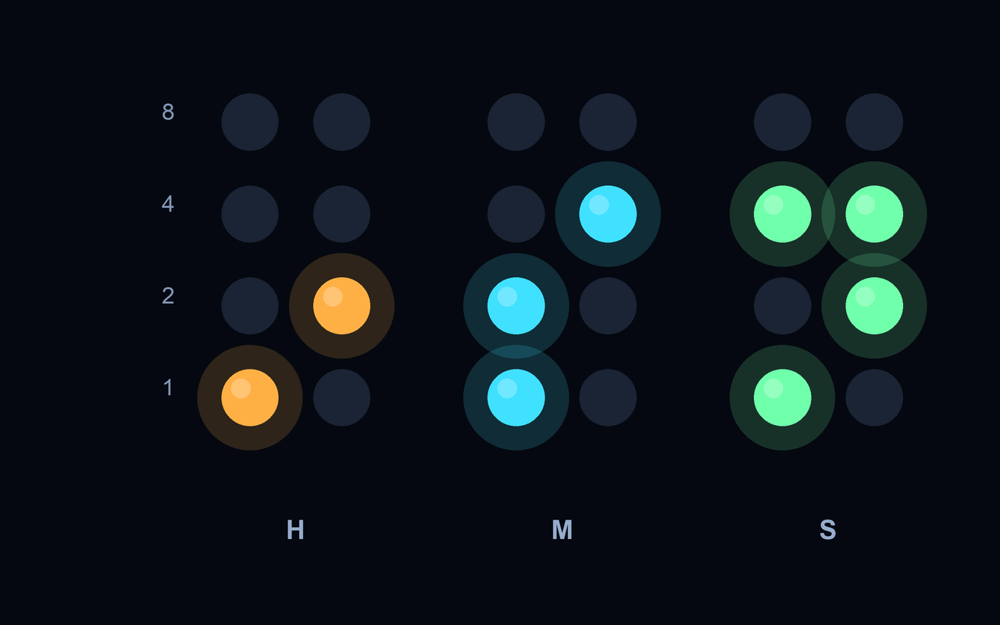

# BinaryClock

`BinaryClock` is a native Haiku screen saver that shows the current time as a
binary-coded decimal (BCD) clock. The hours, minutes and optional seconds are
split into pairs of columns, and each column uses four LEDs to show the bits
8, 4, 2 and 1.



The clock has a quiet default appearance and an optional animation mode driven
by the BView-native ttfx effect engine shared with the repository's other ttfx
screen savers. The upstream [`ttfx-haiku`](https://github.com/sikosis/ttfx-haiku)
renderer targets ANSI terminals, so its visual language is adapted to Haiku
drawing primitives rather than starting a terminal process inside ScreenSaver.

## Features

- Binary-coded decimal hours, minutes and optional seconds
- Four-bit LED columns with optional 8/4/2/1 bit-weight labels
- Optional H/M/S group labels
- 12- or 24-hour time
- Colour-coded hour, minute and second groups
- Optional ttfx animation with expand, slide, wipe, rain, decrypt, scattered,
  waves, colour shift and Matrix effects
- Random or sequential effect order
- Configurable effect interval and transition duration
- Matrix-style binary backdrop during the Matrix effect
- Double-buffered native rendering without flicker
- Deterministic, host-testable clock decoding and bit layout
- Haiku R1/beta6-compatible build and HPKG packaging

## Reading the clock

With seconds enabled there are six columns:

```
  H   H     M   M     S   S
  8 4 2 1   8 4 2 1   8 4 2 1
```

The lit LEDs in each digit column are added together using their bit weights.
For example, a column with the 4 and 1 LEDs lit represents the digit 5. The two
columns in each group form one decimal digit of the hours, minutes or seconds.
The tens column of a value such as `09` still uses all four bits; it simply has
the higher bits switched off.

## Building and testing

Run the portable engine tests:

```sh
make -C tests test
```

Build the native screen saver on Haiku with the development tools installed:

```sh
make -C src
```

Install an unpackaged development copy:

```sh
mkdir -p "/boot/home/config/non-packaged/add-ons/Screen Savers"
cp src/BinaryClock "/boot/home/config/non-packaged/add-ons/Screen Savers/BinaryClock"
screen_blanker BinaryClock
```

Then open **Preferences → ScreenSaver** and select **BinaryClock**.

## Packaging

Create and verify an installable package on Haiku:

```sh
./build-package.sh
```

The script runs the tests, performs a clean native build and creates
`dist/binaryclock_screensaver-1.0.0-1-<architecture>.hpkg`.

Install it with HaikuDepot or from Terminal:

```sh
pkgman install dist/binaryclock_screensaver-1.0.0-1-$(getarch).hpkg
```

Remove any copy from
`/boot/home/config/non-packaged/add-ons/Screen Savers` before testing the
packaged version, otherwise the unpackaged add-on may shadow it.

## Version and licence

- Version: 1.0.0
- Licence: MIT
- ttfx effect engine: adapted from `ttfx-text` and `ttfx-time`, inspired by
  `sikosis/ttfx-haiku`, `omacom/ttfx`, and ChrisBuilds' TerminalTextEffects;
  see `THIRD_PARTY.md`
