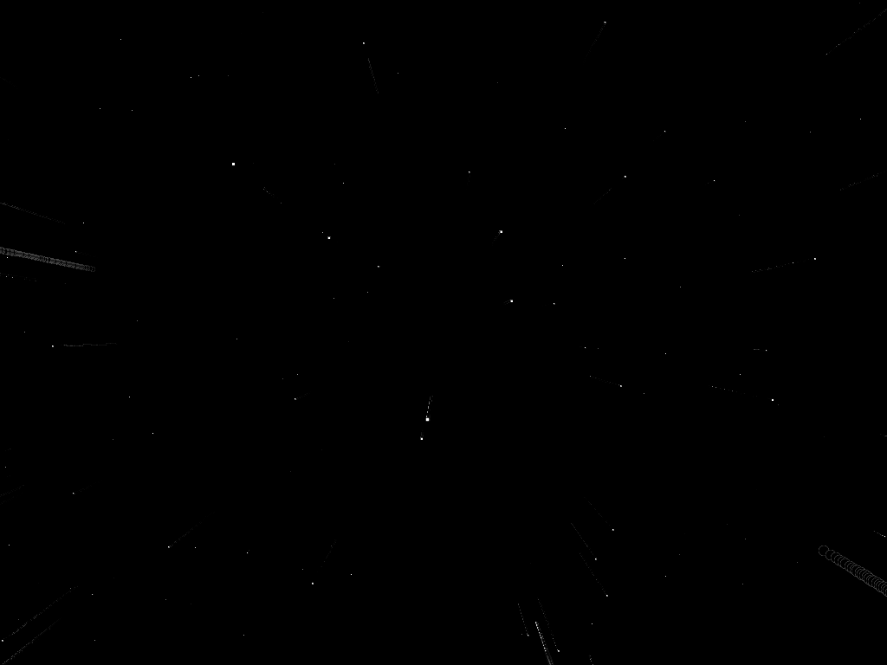

# ScreenSavers

Native screen savers for [Haiku](https://www.haiku-os.org/), maintained and
packaged for current Haiku R1/beta6 systems.

Each screen saver lives in its own folder with its source code, configuration
panel, build files, documentation and HPKG release script. Ready-to-install
packages are available from the [GitHub Releases](https://github.com/sikosis/ScreenSavers/releases)
page.

## Screen savers and releases

| Screen saver | Description | Package version | Release |
| --- | --- | ---: | --- |
| [BrainWash](BrainWash/) | Layered mathematical colour fields with continuously cycling palettes. | 1.4.0-1 | Not yet released |
| [Space](Space/) | A smooth, configurable flight through a three-dimensional star field. | 1.3.0-1 | [Release](https://github.com/sikosis/ScreenSavers/releases/tag/Space-1.3) · [x86_64 HPKG](https://github.com/sikosis/ScreenSavers/releases/download/Space-1.3/space_screensaver-1.3.0-1-x86_64.hpkg) |
| [Substrate](Substrate/) | Intersecting straight and circular cracks deposit translucent coloured sand into crystalline patterns. | 1.1.0-1 | [Release](https://github.com/sikosis/ScreenSavers/releases/tag/Substrate-v1.0) · [x86_64 HPKG](https://github.com/sikosis/ScreenSavers/releases/download/Substrate-v1.0/substrate_screensaver-1.1.0-1-x86_64.hpkg) |
| [ttfx-text](ttfx-text/) | Configurable block text animated with nine native visual effects. | 1.0.0-1 | [Release](https://github.com/sikosis/ScreenSavers/releases/tag/ttfx-text-v1.0) · [x86_64 HPKG](https://github.com/sikosis/ScreenSavers/releases/download/ttfx-text-v1.0/ttfx_text_screensaver-1.0.0-1-x86_64.hpkg) |
| [ttfx-time](ttfx-time/) | A full-screen block clock with rotating text effects, colour palettes and 12- or 24-hour time. | 1.0.0-1 | [Release](https://github.com/sikosis/ScreenSavers/releases/tag/ttfx-time-v1.0) · [x86_64 HPKG](https://github.com/sikosis/ScreenSavers/releases/download/ttfx-time-v1.0/ttfx_time_screensaver-1.0.0-1-x86_64.hpkg) |

Release versions in the table are taken from the published HPKG filenames. A
release title or tag may use a shortened version label.

## Space preview



## Installing a release

Download the HPKG for the screen saver you want, then open it with HaikuDepot
or install it from Terminal:

```sh
pkgman install /path/to/downloaded-package.hpkg
```

Open **Preferences → ScreenSaver** and select the newly installed screen saver.

If you previously installed an unpackaged development copy, remove it from
`~/config/non-packaged/add-ons/Screen Savers` first. An unpackaged copy can
shadow the version supplied by the HPKG.

## Building from source

Builds must be performed on Haiku with the development tools installed. Enter
the selected project folder and build its native add-on:

```sh
cd Space
make -C src
```

Projects with a `tests` folder can run their portable test suite first:

```sh
make -C tests test
```

To create an installable HPKG, run the project-owned release script:

```sh
./build-package.sh
```

See the README inside each project folder for its complete build, testing and
attribution details.

## Repository layout

- `BrainWash`, `Space`, `Substrate`, `ttfx-text` and `ttfx-time` contain the
  maintained screen savers.
- `BrainWash/BrainWash-Old` preserves the original BrainWash source for
  reference and is not a separate release.
- `Space-Original` preserves the original Space source for reference and is not
  a separate release.

## Licences

Licensing and attribution vary by project. Consult the README and licence file
inside each screen saver folder before redistributing its source or package.
